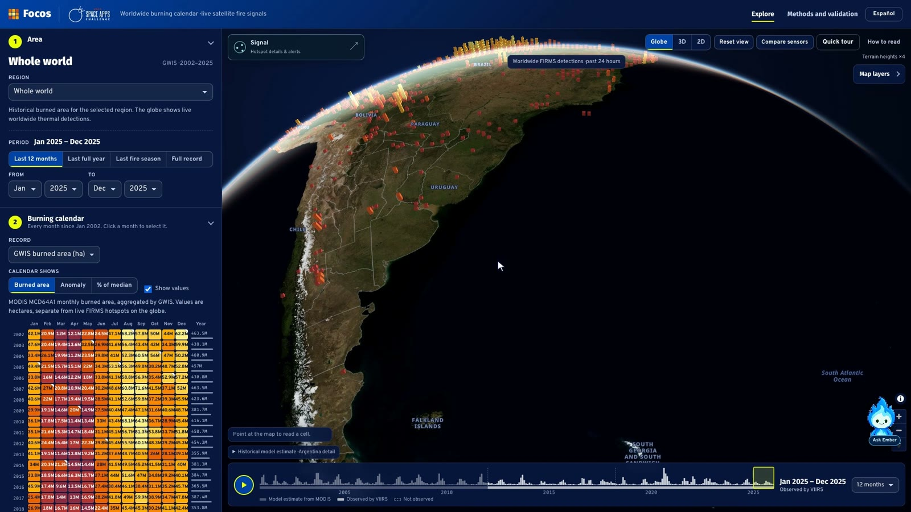
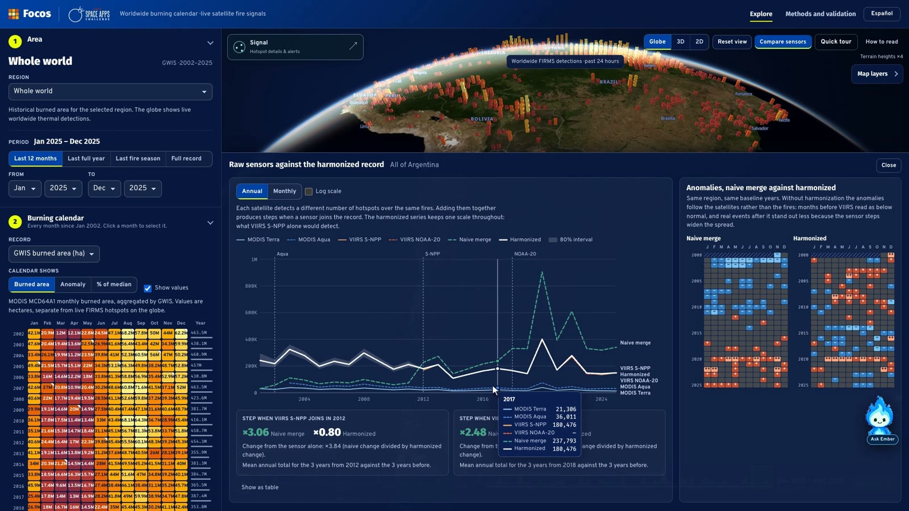
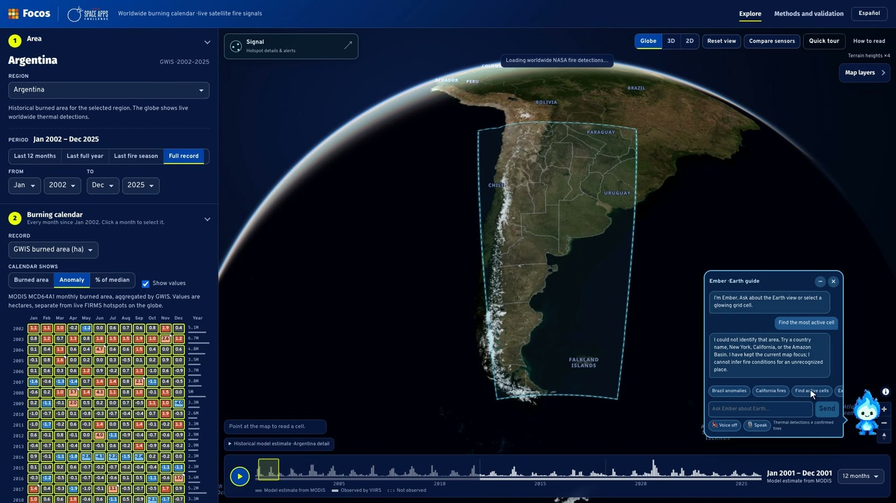

<p align="center">
  
</p>

<h1 align="center">Focos</h1>
<p align="center"><b>Every fire season, on one scale.</b><br>
A worldwide burning calendar built from harmonized NASA MODIS and VIIRS hotspots.<br>
By <b>Orbit and Ember</b> for the 2026 NASA Space Apps Challenge: <i>Harmonization of MODIS and VIIRS Hot Spots</i>.</p>

<p align="center"></p>

## What Focos does

NASA has watched fire from orbit for twenty-five years with two instruments. MODIS (Terra and Aqua, 1 km) has flown since 2000. VIIRS (S-NPP and NOAA-20, 375 m) joined in 2012 and sees far more hotspots over the same fires. Splice the records and fire appears to triple in 2012. Focos harmonizes them into one consistent record, so every month since November 2000 is comparable with every other.

- **Live globe.** Every NASA FIRMS hotspot from the last 24 hours, worldwide, as 3D columns on NASA Blue Marble imagery.
- **Burning calendar.** Every month for any country, province or custom area, coloured by activity, anomaly or percent of the usual.
- **Harmonized record.** Raw sensors against the harmonized series, with the step each sensor adds and the step after harmonization.
- **Unusual months.** Robust anomaly classes and record months flag the seasons that stand out.
- **3D terrain.** Columns rise over NASA SRTM relief, at a detail that follows the camera.
- **Ember.** An Earth guide that explains what you are looking at and flies the globe to the most active fire cells.
- **Signal.** Details for any hotspot and opt-in email alerts for nearby fire activity.
- **Downloads.** Monthly series with intervals, the seasonal profile and every detection, as CSV and PNG.
- **Three languages.** English, Español and Jamaican Patwa.

<p align="center"></p>

## The harmonization

Focos counts the hotspots **a single VIIRS S-NPP observer would detect** in each 0.1° cell and month. One sensor means adding NOAA-20 in 2018 does not double the count, and VIIRS is the record that continues.

1. **Ingest** NASA FIRMS archives for MODIS Collection 6.1 and VIIRS 375 m Collection 2, keeping vegetation fires at nominal and high confidence.
2. **Detect outages** per sensor and scale each month by its observing fraction.
3. **Learn the transfer** from MODIS to VIIRS on the 2012 to 2017 overlap with gradient-boosted trees (Tweedie loss) on local counts, fire radiative power, neighbourhood activity, season and position.
4. **Choose the method by rule**: the lowest province-month error on leave-one-year-out and backcast tests, applied by the pipeline.
5. **Attach an 80% interval** measured on held-out predictions, for any region size.

**Results on years the model never saw** (province-month log error, backcast 2012 to 2014 from MODIS alone):

| Method | Log error |
|---|---|
| **Focos transfer model** | **0.41** |
| National ratio | 0.74 |

The transfer model nearly halves the error of a national ratio, and its 80% interval covers 80.8% of held-out months. Full tables are in [`docs/results.md`](docs/results.md); the method is in [`docs/METHODS.md`](docs/METHODS.md).

<p align="center"></p>

## Run it

The data bundle ships with the repository, so the app runs straight away.

```bash
cd web
npm ci
npm run dev        # http://localhost:5173
```

`npm test` runs the unit tests and `npm run build` makes a static build. `npm run serve:relay` serves the build with the live FIRMS feed and the Signal relay from one Node process.

### Rebuild the record from NASA FIRMS

```bash
uv sync
bash pipeline/download.sh
python -m focos.ingest && python -m focos.grid
python -m focos.harmonize evaluate && python -m focos.harmonize fit
python -m focos.export
```

`docs/DATA_CONTRACT.md` describes every file the pipeline writes and the app reads.

## Data and credits

- Active fire data: NASA FIRMS, MODIS Collection 6.1 and VIIRS 375 m Collection 2.
- Imagery: we acknowledge the use of imagery provided by services from NASA's Global Imagery Browse Services (GIBS), part of NASA's Earth Science Data and Information System (ESDIS).
- Burned area: GWIS / JRC, from MODIS MCD64A1.
- Terrain: SRTM and GMTED2010 terrain data courtesy of the U.S. Geological Survey; global ETOPO1 terrain data U.S. National Oceanic and Atmospheric Administration. Elevation tiles from Terrain Tiles on the Registry of Open Data on AWS.
- Boundaries: Natural Earth. Labels © OpenStreetMap contributors, OpenMapTiles, served by OpenFreeMap.

## Team

**Orbit and Ember**: Sebastien Kawada and Dylan Luke Holyoak.

## License

Apache License 2.0. Built for the 2026 NASA International Space Apps Challenge. Not an official NASA product.
